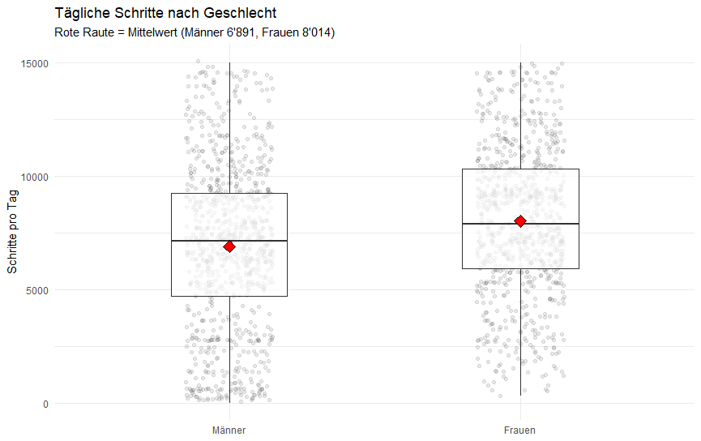
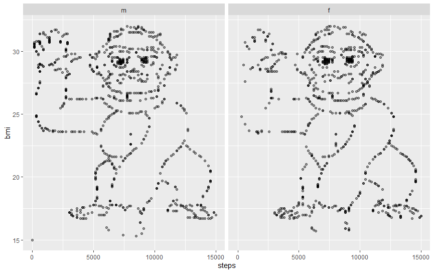
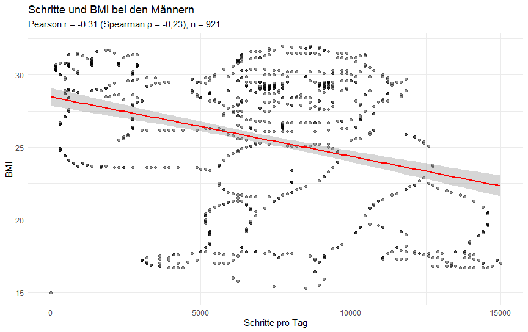
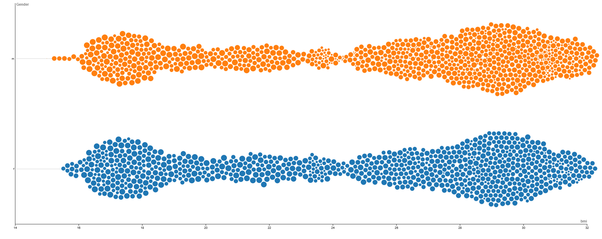
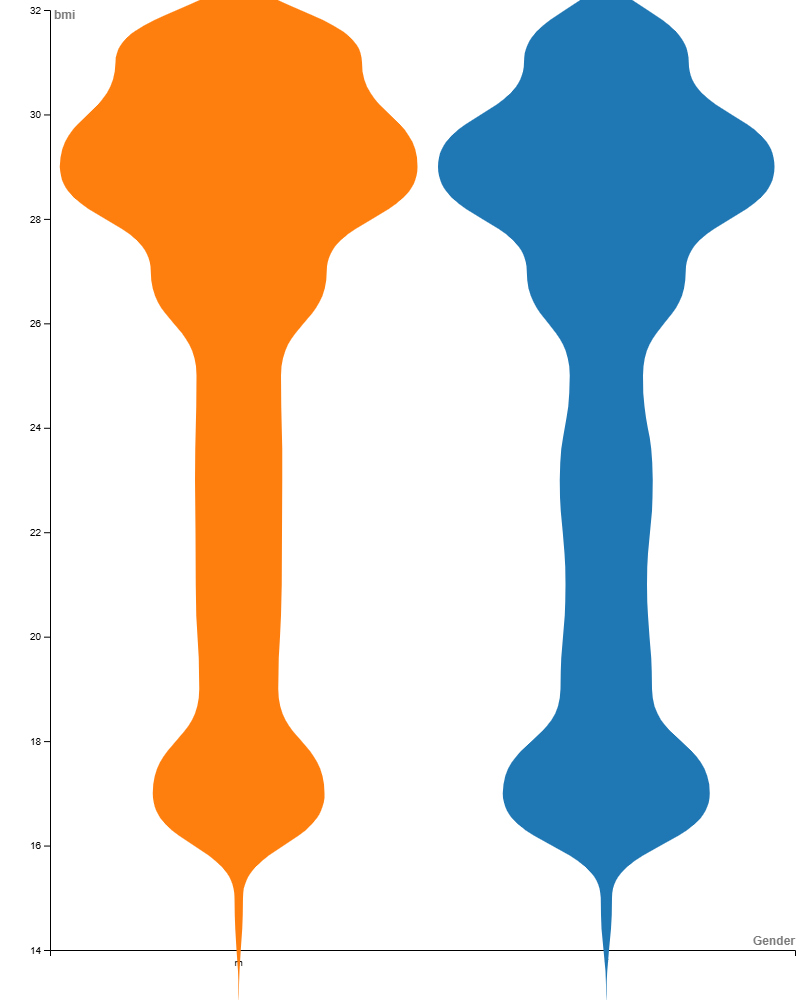
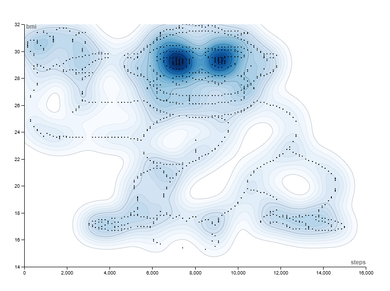
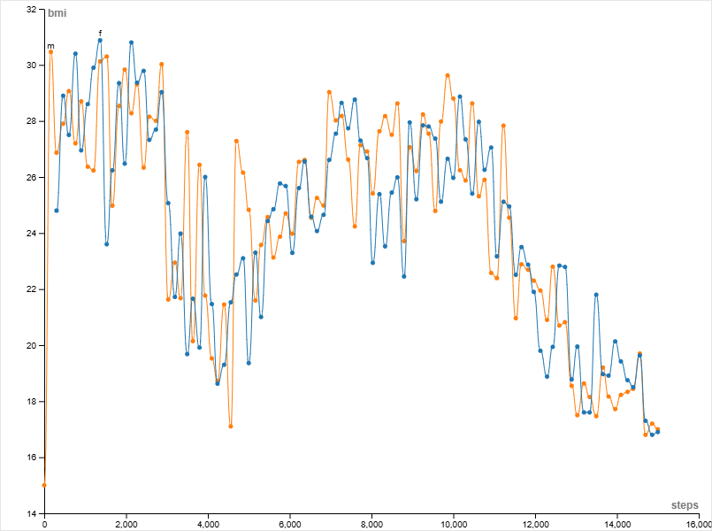

```{r}
#| label: setup
library(tidyverse)
library(readxl)   # einmalig installieren mit: install.packages("readxl")

# Daten einlesen -- Dateinamen anpassen (Spalten: ID, steps, bmi, Gender mit "m"/"f").
# Bei mehreren Tabellenblättern das Blatt angeben: read_excel("daten.xlsx", sheet = "Tabelle1")
daten <- read_excel("Daten.xlsx") |>
  mutate(Gender = factor(Gender, levels = c("m", "f")))

# Hilfsfunktion: zeigt eine Bilddatei an oder, falls sie fehlt, einen grauen Platzhalter.
bild_oder_platzhalter <- function(datei, text = datei) {
  if (file.exists(datei)) {
    knitr::include_graphics(datei)
  } else {
    par(mar = c(0, 0, 0, 0))
    plot.new()
    rect(0, 0, 1, 1, col = "grey90", border = "grey60")
    text(0.5, 0.5, paste("Platzhalter:", text))
  }
}

# Streudiagramm Schritte und BMI nach Geschlecht (wird mehrfach verwendet)
p_streu <- ggplot(daten, aes(x = steps, y = bmi)) +
  geom_point(alpha = 0.4) +
  facet_wrap(~ Gender)
```

<!-- ===================== TITELSEITE ===================== -->

```{=latex}
\thispagestyle{scrheadings}
\vspace*{0.5cm}
\begin{center}
{\bfseries\fontsize{24}{30}\selectfont Auswertung eines Datensatzes\par}
\vspace{1cm}
{\bfseries\fontsize{16}{20}\selectfont Arbeitsblatt 2\par}
\vspace{0.3cm}
{\bfseries\fontsize{16}{20}\selectfont Principles of Data Visualization -- Herbstsemester 2026\par}
\vspace{0.8cm}
\end{center}
```

```{r}
#| label: titelbild
#| fig-align: center
#| fig-width: 8
#| fig-height: 5
#| out-width: "65%"
p_streu
```

```{=latex}
\vfill
\noindent
\begin{tabular}{@{}p{4cm}p{10cm}@{}}
Autor: & Elio Schmid,\\
       & FH Graubünden, MSc Data Visualization\\[1em]
Dozentin: & PD Dr. rer. nat. Helena Jambor\\[1em]
Ort, Datum: & Bern, 06.10.2026
\end{tabular}
\newpage
```

<!-- ===================== INHALT ===================== -->

# Datensatz

## Was beschreibt der Datensatz?

Es werden zwei Datensätze untersucht. Darin werden die Anzahl Schritte pro Tag und der dazugehörige BMI einer Person aufgeführt. Einmal werden die Daten für Jungen dargestellt und einmal für Mädchen. Insgesamt handelt es sich um 1786 Beobachtungen. Davon entfallen 921 auf Jungen und 865 auf Mädchen. Bei der Anzahl Schritten bewegen sich die Beobachtungen zwischen 0/301 (Jungen/Mädchen) und 15'000 (Jungen & Mädchen). Der BMI bewegt sich zwischen 15/15.7 (Jungen/Mädchen) und 32 (Jungen & Mädchen).

## Gibt es einen Unterschied zwischen den mittleren Schrittzahlen der Jungen und Mädchen?

Der Mittelwert der Mädchen und Jungen unterscheidet sich absolut. Mädchen gehen im Mittel 8014 Schritte und Jungen 6891, was einem Unterschied von 1123 entspricht.

| Gender |   n | Mittelwert | Standardabweichung | Median |
|--------|----:|-----------:|-------------------:|-------:|
| m      | 921 |       6891 |               3674 |   7130 |
| f      | 865 |       8014 |               3255 |   7894 |

: Kennzahlen nach Gender der Variable "Anzahl Schritte".

Statistisch gesehen unterscheiden sich die Mittelwerte ebenso. Auf Basis der Annahme, dass die Daten einer Normalverteilung folgen, wurde ein Welch T-Test auf Mittelwertgleichheit durchgeführt. Die Hypothese wurde auf dem 5%-Signifikanzniveau verworfen.



## Gibt es eine positive Korrelation zwischen der Schrittzahl und dem BMI bei Jungen?

Eine positive Korrelation zwischen der Schrittzahl und dem BMI bei Jungen gibt es in dem Sinne nicht, als dass man sagen kann, dass bei höherer Schrittzahl der BMI zunimmt (statistisch würde dies einem positiven Zusammenhang entsprechen). Es ist eher das Gegenteil der Fall, dass die Daten negativ korrelieren, was in dem Sinne eine positive Aussage sein könnte. Nämlich je mehr Schritte desto niedriger der BMI. Wichtig zu erwähnen ist, dass diese Feststellung noch nicht einer Ursache-Wirkungs-Beziehung entspricht. Es wäre falsch zu behaupten, dass der BMI sinkt, je mehr Schritte ein Junge macht.

Wenn wir die Daten in einem Streudiagramm darstellen, sehen wir dass dadurch eine Figur entsteht. Somit ist der rechnerisch belegte Zusammenhang doch äusserst fraglich. Dies ist sowohl bei den Jungen als auch bei den Mädchen der Fall.



In der folgenden Abbildung wurde dem Streudiagramm die dazugehörige Regressionsgerade hinzugefügt. Die Punkte folgen keiner einfachen linearen Beziehung.



## Welche weiteren Schlüsse können ihr bilden, oder Hypothesen aufstellen?

- Gibt es einen Unterschied zwischen den mittleren BMI der Mädchen und Jungen?
- Besteht auch bei den Mädchen einen negativen Zusammenhang zwischen Anzahl Schritte und BMI?
- Weisen die Jungen bei den Anzahl Schritten eine höhere Streuung auf als die Mädchen?
- Welche Personen Gruppe geht mehr pro Tag?

# Iterationen

## Beeswarm Chart



Dieser Chart ist insofern interessant, als dass sich relativ gut erkennen lässt, dass es auch Personen mit hohem BMI gibt, die täglich eine grosse Anzahl Schritte machen. Zeitgleich gibt es Personen, die eine niedrige Anzahl täglicher Schritte haben, die aber als Normalgewichtig eingestuft werden. Diese Visualisierung funktioniert meiner Meinung nach fast noch besser als interaktive Darstellung.

## Violine Plot



Bei diesem Chart hatte ich in der Erstellung Mühe. Die Visualisierung sagt aus, welche BMI's wie häufig vorkommen. Jedoch zieht es mir den Chart unter die X-Achse obschon keine Werte unter 14 bestehen. Somit stufe ich diesen Chart als wenig hilfreich ein.

## Contour Plot



Zusätzliche Darstellung zum Streudiagramm, wo mit der Farbgebung eine Art Heatmap erstellt wird. Je dunkler desto mehr Datenpunkte sind in einem Bereich vorhanden.

## Line Chart



In dieser Visualisierung wird der durchschnittliche BMI bei einer gewissen Anzahl Schritte als Linien Chart dargestellt. Die Daten der Jungen sind in Orange und die Daten der Mädchen in Blau dargestellt. Die Visualisierung liest sich wie folgt. Der durchschnittliche BMI der Jungen, die 0 tägliche Schritte absolvierten ist 15 (genau 1 Beobachtung). Aus dieser Grafik können wir lesen, dass der BMI je nach Anzahl Schritte von eher Tief zu eher Hoch schwankt.

# Abschluss Teil 1

Alles in Allem finde ich, dass für die Darstellung dieser Daten das Streudiagramm am aussagekräftigsten ist. Ich habe die Auswahl verschiedener Visualisierungen als anspruchsvoll wahrgenommen und habe gemerkt, dass ich mich mit diesen Tools noch stärker auseinandersetzen muss, damit ich gelungene Visualisierungen umsetzen kann.

# Aufgabe 2 Teil 2

## Euere eigenen Analysen und Daten zu Gesundheit und Nachhaltigkeit

Anfang Oktober habe ich einen Artikel von SRF über den Gletscherschwund in der Schweiz gelesen. Der Artikel ist hier [verlinkt.](https://www.srf.ch/wissen/klimawandel/eisverlust-2026-massive-gletscherschmelze-so-viel-eis-verschwand-im-hitzesommer) Darin wird auf Daten von Glamos - Glacier Monitoring in Switzerland verwiesen. Das Thema interessiert mich insofern, als dass ich relativ viel in den Bergen unterwegs bin. Auf der Website von Glamos finden wir Daten zu Bestand, Längenänderung, Massenbilanz, Volumenänderung sowie Szenarien. Die Daten unterscheiden sich in Stichtagsmessungen und Zeitreihen. Es werden Flächen-, Ausdehnungs- und Geodaten erfasst. In meiner Analyse möchte ich mich auf die Volumenänderung konzentrieren. Ich kann mir aber vorstellen auch Bestandesdaten einfliessen zu lassen oder Längenänderungen. Dies werde ich im Zuge der Auswertung wohl feststellen. Der Datensatz, den ich analysieren möchte, lässt sich [hier](https://doi.glamos.ch/data/volumechange/volumechange_2025_r2025.html) einsehen.

# Aufgabe 3

## Setup

```{r}
#| label: setup
#| message: false
#| warning: false

library(tidyverse)   # dplyr, ggplot2, readr, stringr, forcats, lubridate

theme_set(theme_minimal(base_size = 12))

pfad <- "volumechange.csv"   # ggf. anpassen, z. B. "daten/volumechange.csv"
```

## Daten einlesen

Die Datei enthält 6 Zeilen Metadaten, die Kopfzeile (Zeile 7) und eine
Einheitenzeile (Zeile 8). Die Daten beginnen erst in Zeile 9.

```{r}
#| label: einlesen
#| message: false

zeilen <- read_lines(pfad)
kopf   <- strsplit(zeilen[7], ",")[[1]]

roh <- read_csv(
  I(paste(zeilen[-(1:8)], collapse = "\n")),
  col_names = kopf,
  col_types = cols(
    .default     = col_double(),
    `SGI-ID`     = col_character(),
    source_start = col_character(),
    source_end   = col_character(),
    date_start   = col_character(),   # Format yyyymmdd, teils mit 99/00
    date_end     = col_character(),
    Name         = col_character()
  ),
  trim_ws = TRUE
)

glimpse(roh)
```

## Bereinigung

```{r}
#| label: bereinigung

# Datum yyyymmdd: Monat/Tag 99 oder 00 = unbekannt -> Schätzung 1. August
parse_datum <- function(x) {
  jahr <- str_sub(x, 1, 4)
  mon  <- str_sub(x, 5, 6)
  tag  <- str_sub(x, 7, 8)
  unbekannt <- mon %in% c("99", "00")
  mon[unbekannt] <- "08"
  tag[unbekannt | tag %in% c("00", "99")] <- "01"
  ymd(paste0(jahr, mon, tag))
}

gl <- roh |>
  rename(
    sgi_id         = `SGI-ID`,
    name           = Name,
    area_start_km2 = A_start,
    area_end_km2   = A_end,
    dv_km3         = dV,
    dh_mean_m      = dh_mean,
    bgeod_mwe_a    = Bgeod,
    sigma_mwe      = sigma,
    covered_pct    = covered
  ) |>
  mutate(
    # Datum
    datum_exakt_start = !str_sub(date_start, 5, 6) %in% c("99", "00"),
    datum_exakt_end   = !str_sub(date_end,   5, 6) %in% c("99", "00"),
    dt_start     = parse_datum(date_start),
    dt_end       = parse_datum(date_end),
    jahr_start   = year(dt_start),
    jahr_end     = year(dt_end),
    jahr_mitte   = (jahr_start + jahr_end) / 2,
    periode_jahre = as.numeric(dt_end - dt_start) / 365.25,
    # Fläche 0 = nicht kartiert -> fehlender Wert
    area_start_km2 = na_if(area_start_km2, 0),
    area_end_km2   = na_if(area_end_km2, 0),
    # Gruppierungen
    einzugsgebiet  = str_sub(sgi_id, 1, 1),
    groessenklasse = cut(
      area_start_km2,
      breaks = c(0, 0.1, 0.5, 2, 10, Inf),
      labels = c("<0.1", "0.1-0.5", "0.5-2", "2-10", ">10")
    ),
    massenzunahme = bgeod_mwe_a > 0,
    signifikant   = abs(bgeod_mwe_a) > 2 * sigma_mwe
  ) |>
  select(-rho_dv, -date_start, -date_end) |>   # rho_dv ist überall 850
  group_by(sgi_id) |>
  mutate(n_perioden = n()) |>
  ungroup()

# Pro Gletscher nur die längste Messperiode (vermeidet Mehrfachzählung)
gl_lang <- gl |>
  group_by(sgi_id) |>
  slice_max(periode_jahre, n = 1, with_ties = FALSE) |>
  ungroup()
```

## Datenqualität

```{r}
#| label: qualitaet

# Fehlende Werte je Spalte
gl |>
  summarise(across(everything(), ~ sum(is.na(.x)))) |>
  pivot_longer(everything(), names_to = "variable", values_to = "n_na") |>
  filter(n_na > 0)

# Anteil geschätzter Datumsangaben
gl |>
  summarise(
    start_geschaetzt = mean(!datum_exakt_start),
    ende_geschaetzt  = mean(!datum_exakt_end)
  )

# Gleiche Namen bei verschiedenen IDs
gl |>
  distinct(sgi_id, name) |>
  count(name) |>
  filter(n > 1)
```

## Basiskennzahlen

```{r}
#| label: kennzahlen

tibble(
  anzahl_zeilen          = nrow(gl),
  anzahl_gletscher       = n_distinct(gl$sgi_id),
  perioden_pro_gletscher = median(gl$n_perioden),
  zeitraum_von           = min(gl$jahr_start),
  zeitraum_bis           = max(gl$jahr_end),
  median_bgeod           = median(gl_lang$bgeod_mwe_a),
  anteil_negativ         = mean(gl_lang$bgeod_mwe_a < 0)
)

summary(gl_lang |> select(area_start_km2, dv_km3, dh_mean_m, bgeod_mwe_a, sigma_mwe, periode_jahre))
```

## Deskriptive Statistik nach Gruppen

```{r}
#| label: gruppen

gl_lang |>
  group_by(einzugsgebiet) |>
  summarise(
    n         = n(),
    median    = median(bgeod_mwe_a),
    mittel    = mean(bgeod_mwe_a),
    sd        = sd(bgeod_mwe_a),
    dv_summe_km3 = sum(dv_km3),
    .groups = "drop"
  )

gl_lang |>
  filter(!is.na(groessenklasse)) |>
  group_by(groessenklasse) |>
  summarise(
    n      = n(),
    median = median(bgeod_mwe_a),
    mittel = mean(bgeod_mwe_a),
    sd     = sd(bgeod_mwe_a),
    .groups = "drop"
  )
```

## Visualisierungen

### Verteilung der Massenbilanz

```{r}
#| label: fig-hist
#| fig-cap: "Verteilung der geodätischen Massenbilanz (längste Periode je Gletscher)"

ggplot(gl_lang, aes(bgeod_mwe_a)) +
  geom_histogram(bins = 50, fill = "#2a7ab0") +
  geom_vline(xintercept = median(gl_lang$bgeod_mwe_a), linetype = "dashed") +
  labs(x = "Massenbilanz [m w.e. a⁻¹]", y = "Anzahl Gletscher")
```

### Gletschergrösse und Massenbilanz

```{r}
#| label: fig-scatter
#| fig-cap: "Gletscherfläche (Start) und Massenbilanz"
#| warning: false

ggplot(gl_lang, aes(area_start_km2, bgeod_mwe_a, colour = einzugsgebiet)) +
  geom_point(alpha = 0.5) +
  scale_x_log10() +
  labs(x = "Fläche Start [km², log]", y = "Massenbilanz [m w.e. a⁻¹]",
       colour = "Einzugsgebiet")
```

### Massenbilanz nach Gruppen

```{r}
#| label: fig-box
#| fig-cap: "Massenbilanz nach Grössenklasse"

gl_lang |>
  filter(!is.na(groessenklasse)) |>
  ggplot(aes(groessenklasse, bgeod_mwe_a)) +
  geom_boxplot(fill = "#9ecae1") +
  labs(x = "Flächenklasse [km²]", y = "Massenbilanz [m w.e. a⁻¹]")
```

### Zeitverlauf

Nur Perioden von 4 bis 15 Jahren, damit die Werte vergleichbar sind.

```{r}
#| label: fig-zeit
#| fig-cap: "Massenbilanz im Zeitverlauf (Median und Quartile, 5-Jahres-Klassen)"

gl |>
  filter(periode_jahre >= 4, periode_jahre <= 15) |>
  mutate(klasse = floor(jahr_mitte / 5) * 5) |>
  group_by(klasse) |>
  summarise(
    median = median(bgeod_mwe_a),
    q1     = quantile(bgeod_mwe_a, 0.25),
    q3     = quantile(bgeod_mwe_a, 0.75),
    n      = n(),
    .groups = "drop"
  ) |>
  ggplot(aes(klasse, median)) +
  geom_ribbon(aes(ymin = q1, ymax = q3), alpha = 0.25, fill = "#2a7ab0") +
  geom_line(colour = "#2a7ab0") +
  geom_point(colour = "#2a7ab0") +
  labs(x = "Mittleres Jahr der Periode", y = "Massenbilanz [m w.e. a⁻¹]")
```

### Grösste Volumenverluste

```{r}
#| label: fig-top10
#| fig-cap: "Die 10 Gletscher mit dem grössten Volumenverlust (längste Periode)"

gl_lang |>
  slice_min(dv_km3, n = 10) |>
  mutate(name = fct_reorder(name, -dv_km3)) |>
  ggplot(aes(dv_km3, name)) +
  geom_col(fill = "#2a7ab0") +
  labs(x = "Volumenänderung [km³]", y = NULL)
```

## Einfache Zusammenhangsprüfung

```{r}
#| label: tests

# Fläche vs. Massenbilanz (Rangkorrelation, da Fläche stark schief verteilt)
cor.test(gl_lang$area_start_km2, gl_lang$bgeod_mwe_a,
         method = "spearman", exact = FALSE)

# Unterscheiden sich die Einzugsgebiete?
kruskal.test(bgeod_mwe_a ~ einzugsgebiet, data = gl_lang)
```